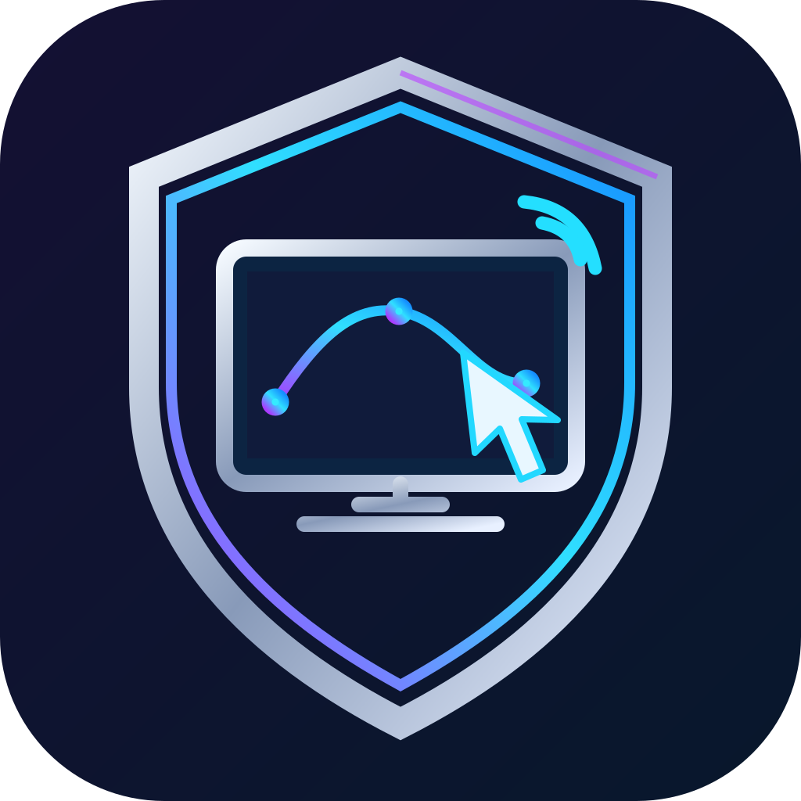

<p align="center"></p>
<h1 align="center">WMK Remote Support</h1>
<p align="center"><strong>Suporte remoto e assistência técnica • Código aberto • Windows, macOS, Linux, Android e navegador</strong></p>
<p align="center"><em>Projeto em desenvolvimento — baseado no Airhand 0.2.3</em></p>

> **Estado atual:** o motor de acesso remoto deriva do Airhand e ainda precisa de compilação, testes de segurança e validação operacional. Cadastro de clientes, chamados, diagnósticos e IA são funcionalidades **planejadas**, não disponíveis nesta versão.
>
> **Atenção:** a arte de apresentação aprovada para o projeto é a logo futurista WMK. O arquivo vetorial desta etapa é um ícone simplificado inspirado na mesma identidade; os ícones binários dos instaladores ainda precisam ser gerados e substituídos.

📘 **[Manual HTML: o que já existe no WMK Remote Support](manuais/o-que-existe.html)** — funcionalidades, arquitetura, plataformas, limitações, testes e créditos.

📊 **[Pesquisa comparativa AnyDesk e WMK](manuais/pesquisa-anydesk.html)** — estudo das capturas, perfis de permissão, identificadores e instalação sem configuração.

## Sobre o projeto

O **WMK Remote Support** é uma iniciativa de transformar um software de desktop remoto em uma plataforma de atendimento técnico: conexões seguras com autorização, suporte a clientes, diagnóstico, histórico de chamados e documentação acessível em português brasileiro.

O mecanismo existente utiliza **QUIC/TLS 1.3**, criptografia ponta a ponta entre os dispositivos, codecs **AV1 / HEVC / H.264** quando suportados, conexão direta quando possível e retransmissão por servidor próprio como alternativa. O software cliente utiliza **Rust + Tauri 2 + React/TypeScript**. O aplicativo Android utiliza **Kotlin** e um núcleo em Rust.

## Funcionalidades existentes no núcleo do WMK Remote Support

- Controle de tela, mouse e teclado;
- Conexão por código de controle de seis dígitos e pareamento inicial;
- Serviço Windows para tela de login e UAC, quando instalado adequadamente;
- Console com abas, múltiplos monitores e várias sessões;
- Acesso pelo navegador com serviço de console web;
- Compartilhamento de tela e controle no Android (com permissões do sistema);
- Áudio remoto, sincronização de área de transferência **apenas para texto**;
- Ajustes de resolução, FPS, bitrate e codec;
- Criptografia de ponta a ponta para sessões cliente-cliente;
- Servidor intermediário hospedável pelo próprio operador.

As funcionalidades acima constam no código/documentação do projeto base; **não constituem certificação de funcionamento nesta distribuição WMK**.

## Limitações conhecidas

- Transferência de arquivos ainda não existe; a área de transferência compartilha texto.
- Hosts Linux suportam X11, não Wayland completo.
- No Windows, o envio de Ctrl+Alt+Del não está implementado.
- O console web exige um serviço adicional, e o serviço pode visualizar o conteúdo descriptografado das sessões.
- Rede corporativa e bloqueio de UDP podem impedir caminho direto; o relay continua necessário.
- O servidor requer configuração e porta **UDP 4433**.
- A interface do aplicativo ainda não está totalmente traduzida para português.

Veja [limitações técnicas](docs/limitations.md) e [segurança](docs/security.md) no material original, disponível em inglês.

## Começando no Windows (desenvolvedores)

### 1. Infraestrutura de comunicação

O WMK Remote Support requer um servidor intermediário acessível por ambos os computadores. O arquivo `docker-compose.yml` original descreve o serviço; o servidor mantém certificado e banco de códigos no diretório persistente `data/`.

```bash
docker compose up -d
docker compose logs
```

Registre o fingerprint SHA-256 do certificado gerado. Não apague `data/` nem exponha as informações secretas do servidor.

### 2. Compilar o cliente

Pré-requisitos: **Rust estável**, **Node.js** compatível com o projeto, **CMake**, ambiente **MSVC** com ferramentas C++ e WebView2 no Windows.

```powershell
git clone https://github.com/WalneyNF/WMK-Remote-Support.git
cd WMK-Remote-Support\client
npm ci
$env:AIRHAND_SERVER = "relay.exemplo.com:4433"
$env:AIRHAND_SERVER_FP = "COLOQUE_O_FINGERPRINT_SHA256_AQUI"
npm run tauri build
```

**Nota de compatibilidade:** os nomes internos `AIRHAND_SERVER` e `AIRHAND_SERVER_FP` foram mantidos deliberadamente para não romper o protocolo/configuração existente nesta etapa. Coloque o endereço e o fingerprint do **seu** relay, não os valores de exemplo.

O instalador NSIS deverá ser criado sob `client/src-tauri/target/release/bundle/nsis/` quando o build terminar com sucesso.

### 3. Conectar dois computadores

Instale o aplicativo em ambos, configure o mesmo servidor, obtenha no host o código de controle e informe-o na estação do técnico. Na primeira conexão, conclua o pareamento pelo código mostrado ao usuário do host. Teste sempre em duas máquinas próprias e com autorização explícita.

## Compilação pelo GitHub Actions

Na aba **Actions**, selecione **Windows — compilação WMK** e execute **Run workflow** (quando o workflow estiver disponível na branch). O pipeline valida o frontend e tenta produzir um instalador de testes; se não houver servidor configurado, os binários gerados não estarão prontos para suporte pela internet.

Artefatos de Actions **não são automaticamente Releases públicas**. Primeiro validaremos a compilação e as conexões.

## Transferência de arquivos e tempo de sessão

**Transferência de arquivos (em desenvolvimento):** pretendemos permitir enviar arquivos do computador do técnico para o cliente e baixar arquivos autorizados do cliente. Isso ainda **não está disponível no protocolo atual**. Não confundir com a área de transferência de texto existente.

A implementação será bidirecional, com seleção explícita dos arquivos, confirmação do cliente, barra de progresso, cancelamento, hash SHA-256, limites de tamanho configuráveis, proteção contra caminhos indevidos e registro do atendimento. A transferência precisa ocorrer dentro da sessão criptografada; não enviaremos arquivos para armazenamento público no relay.

**Duração da sessão:** o console apresenta um contador de tempo conectado, sem limite de tempo artificial. Ele soma apenas o período em que a sessão está ativa, não o tempo offline ou aguardando autorização. A sessão ainda pode cair por rede, término solicitado pelo cliente, recursos do servidor ou desligamento do PC.

## Como testar e acessar pelo celular

1. Configure um servidor relay acessível (UDP 4433) e distribua clientes que confiem no fingerprint do certificado.
2. Instale o aplicativo em dois computadores próprios. No computador do cliente, obtenha o código de controle e o código de pareamento; no computador do técnico, selecione o modo controlador e digite os códigos.
3. Teste tela, mouse, teclado, áudio, várias telas, reconexão e o cronômetro. Em apenas **um PC**, o teste de si próprio pode gerar efeito de espelhos e não substitui um teste entre duas máquinas; prefira outra máquina física ou VM.
4. Para controlar pelo **Android**, compile/instale o aplicativo em `android/`, configurado para o mesmo relay, e conecte usando o código remoto. O suporte Android está documentado em [docs/android.md](docs/android.md). O aplicativo de celular ainda não possui nossa identidade e tradução completas.
5. Para controlar por **navegador**, é necessário configurar o serviço em `web/` com HTTPS/WebCodecs; não basta visitar a página do GitHub.

Consulte também o [guia de funcionalidades e testes](manuais/o-que-existe.html) e o [plano de transferência de arquivos](manuais/transferencia-e-testes.md).

## Evidências de suporte — captura de tela

O botão **Capturar tela** foi implementado na barra de ferramentas da sessão remota. Ele solicita um PNG do quadro remoto decodificado, com nome sugerido `WMK-Captura-CODIGO-DATA.png`. Quando o sistema suporta o seletor nativo, você escolhe a pasta e o nome; caso contrário, o navegador disponibiliza o download. A funcionalidade depende de conexão ativa e **ainda requer teste em ambiente real**.

A transferência de arquivos **ainda não existe** e não deve ser confundida com o recurso de captura ou com a área de transferência de texto. Sua implementação segura e bidirecional é prioridade P0 do [roadmap](manuais/roadmap.html).

📹 **[Gravação e auditoria de sessões](manuais/gravacao-auditoria.html)** — estudo técnico sobre vídeo, relatórios, integridade, consentimento e política empresarial. **Funcionalidade planejada: ainda não disponível no aplicativo.**

## Evolução WMK

Consulte o [roadmap interativo em HTML](manuais/roadmap.html), o [estado de evolução JSON](manuais/evolucao.json) e o [ROADMAP.md](ROADMAP.md) para as prioridades e os critérios de validação.

## Segurança e consentimento

O acesso remoto exige autorização, identificação do técnico, possibilidade visível de desconectar, uso de um relay confiável e proteção dos códigos/segredos de pareamento. **Nunca habilite acesso irrestrito em computadores de clientes.** O serviço do Windows pode operar como SYSTEM: uma sessão comprometida pode ter controle administrativo da máquina.

## Créditos, licença e autoria

**WMK Remote Support — personalização e desenvolvimento:** Walney Moreira Klein — walneyk@hotmail.com.

**Créditos históricos e licença:** [projeto original, por sqlpxc](https://github.com/sqlpxc/airhand).

**Licença:** MIT. O arquivo [LICENSE](LICENSE) mantém os direitos autorais originais. As mudanças WMK devem preservar as notas e atribuições exigidas por essa licença.

---
*Este repositório é um projeto independente e não é afiliado a AnyDesk ou TeamViewer.*
